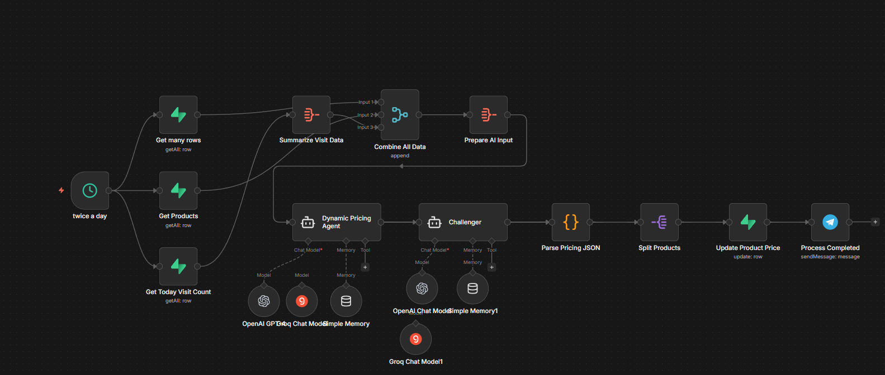
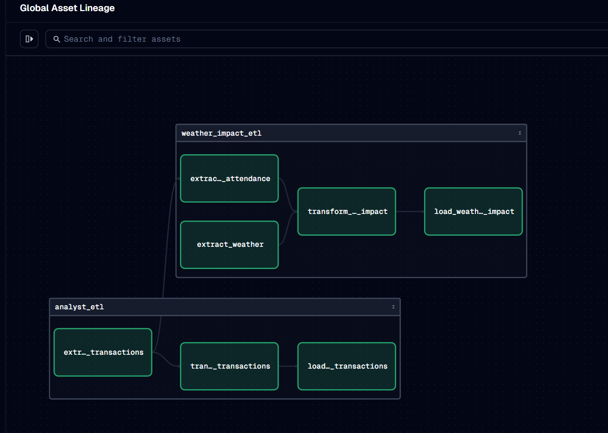
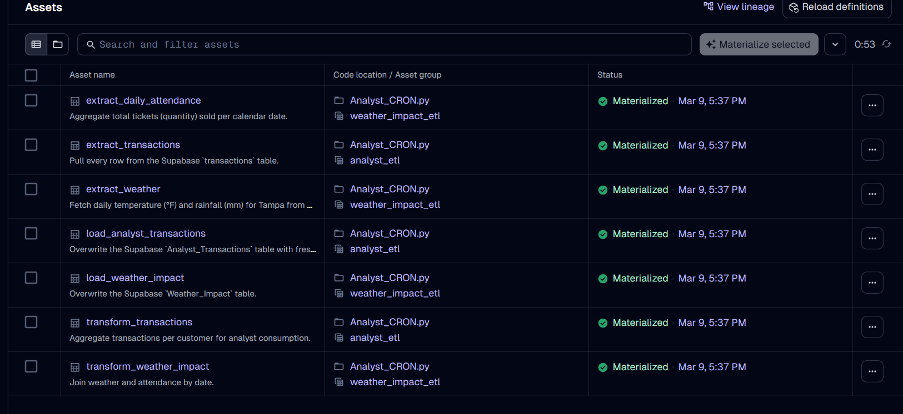
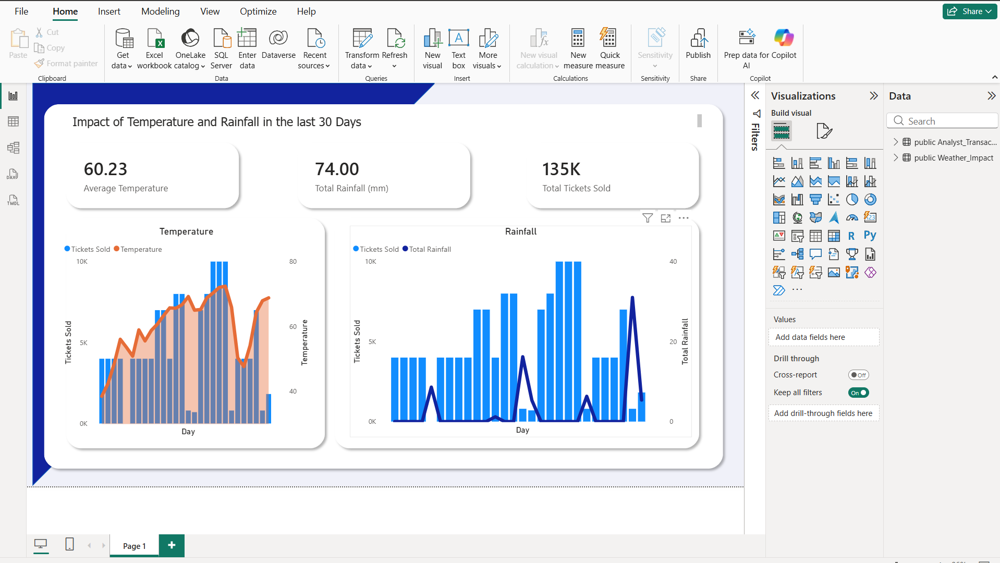

# loganmansfield.org — portfolio

Personal portfolio for **Logan Mansfield, Data Analyst** (Tampa, FL — open to
remote). Static HTML/CSS/JS, no build step, deployed on Vercel.

## Site structure

A deliberately lean two-page site, plus one archived project page:

- **Home** (`index.html`, `/`) — intro and availability, a three-line "now"
  strip, three featured projects, an experience timeline, credentials and
  toolkit, a short about, and the fastest ways to connect.
- **Projects** (`projects.html`, `/projects`) — featured: the Fraud Detection
  Pipeline, Owl Park, and Lighthouse; then Quack Query, USL Attendance
  Forecasting, Roll Call, eFrog (live), Attendance Nowcast, Member
  Segmentation (RFM), and the archived Owl Park data architecture. Cards have
  anchor ids (`#fraud`, `#owl-park`, `#lighthouse`, …) so the home page can
  deep-link to them.
- **Owl Park** (`owl-park-infographic.html`, `/owl-park`) — a standalone
  infographic of the archived end-to-end data pipeline.
- **404** (`404.html`) — branded not-found page.

Clean URLs (`/projects`, `/owl-park`) and legacy redirects are configured in
`vercel.json`.

## Design: "Barn Owl"

The palette is taken from the barn owl (*Tyto alba*): the pale heart-shaped
facial disc and cream breast as the page surfaces, deep eye-brown as ink, the
plumage browns (tan → caramel → chestnut → umber) as warm accents, and one
creamy, milk-washed blue as the action color (links, buttons, focus ring,
soft fills). Day is the default theme; Night follows
`prefers-color-scheme: dark`. Every text/background pair meets WCAG AA.

Type is Fraunces (display, 600) for headlines and Figtree for everything else,
loaded from Google Fonts; code uses the system monospace stack. Corners are
soft and tappable things are pills.

## Assets

- `assets/tokens.css` — design tokens (Day + Night palette, type, radii,
  shadows, motion). Imported first on every page.
- `assets/shell.css` — ambient background, top bar, nav, footer, focus rings,
  view transitions.
- `assets/pages.css` — page components: hero, now strip, project cards,
  experience timeline, chips, about, connect cards, buttons.
- `assets/transition.js` — SPA-style page transitions and the mobile nav.
- `assets/theme.js` — optional per-company accent theming via `?ink=<company>`
  (see [`docs/referrers.md`](docs/referrers.md)).
- `assets/profilepicture.webp` — circular hero avatar on the home page.
- `assets/crow.png`, `assets/favicon-crow.png`, `mini.jpg` — the crow mark
  (painted via CSS mask), favicon, and share image.
- `assets/apple-touch-icon.png`, `assets/icon-192.png`, `assets/icon-512.png`
  — home-screen icons referenced from `manifest.json`.
- `assets/loganmansfield.pdf` — résumé served from the site.

The pages load the minified `.min` variants. After editing any source asset,
regenerate its minified file:

    npx esbuild <src> --minify --outfile=<min> --allow-overwrite

## Local development

No build step — serve the folder and open it:

    python3 -m http.server 8000

Note that `vercel.json` clean URLs/redirects aren't applied by a plain static
server; `vercel dev` reproduces production routing if needed.

## Validation gate

Portfolio changes are validated with the `no-mistakes` skill (`/no-mistakes`)
before opening a PR. See [`CLAUDE.md`](CLAUDE.md) for setup and environment
notes.

## Owl Park (archived project)

An earlier end-to-end pipeline built around a simulated ticket-sales
ecosystem: n8n agents generated demand and managed stock, data landed in
Supabase, Microsoft Fabric modeled it with a medallion architecture, and
Power BI turned it into decisions. A few visuals from that work:

