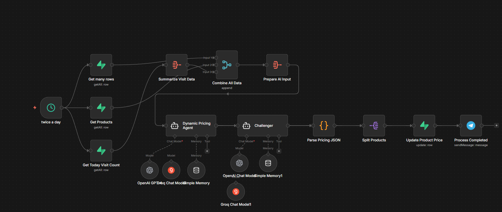
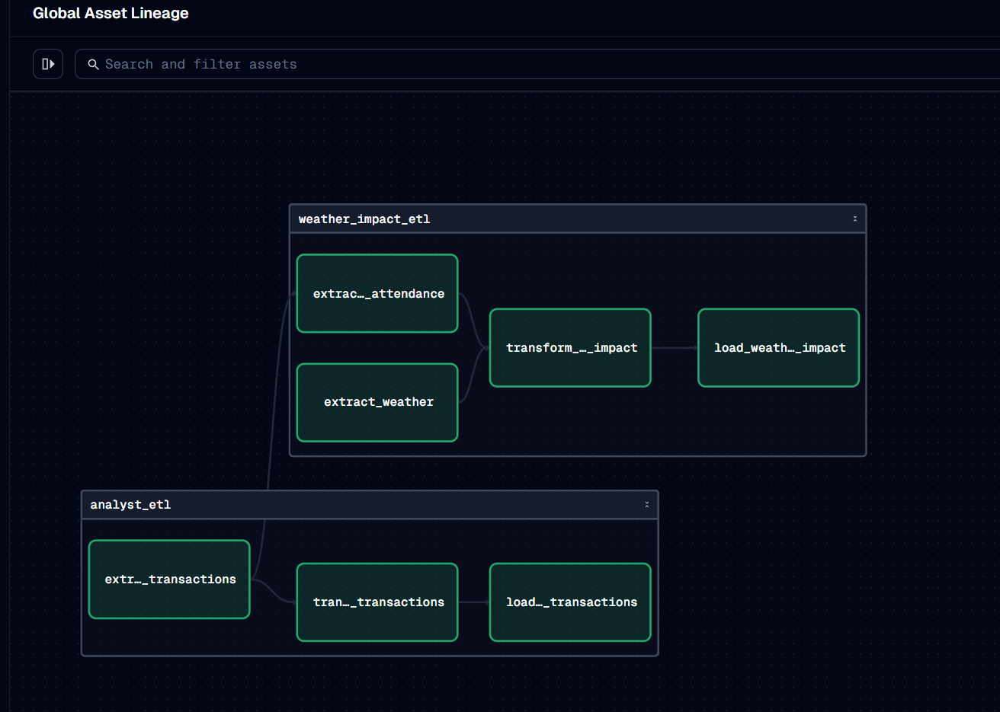
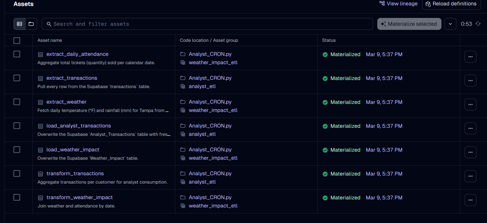
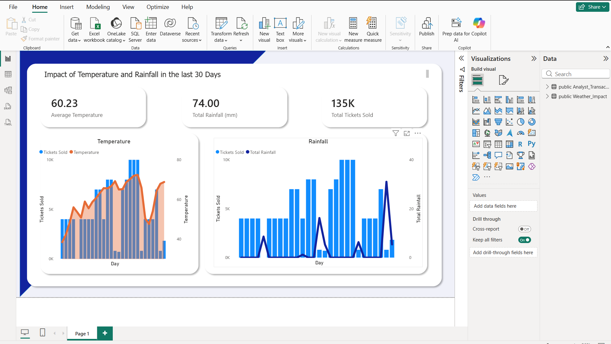

# loganmansfield.org — portfolio

Personal portfolio for **Logan Mansfield**, a data analyst moving into
analytics engineering (Tampa, FL — open to remote and relocation). Static
HTML/CSS/JS, no build step, deployed on Vercel.

## Site structure

A deliberately lean two-page site, plus a live data page and one archived
project page:

- **Home** (`index.html`, `/`) — intro and contact buttons
  (résumé PDF, email, LinkedIn, GitHub), a three-line "now" strip, three
  featured projects, an experience timeline, credentials (certifications; the
  degree line is hidden for now, see "Hidden for now" below)
  and a toolkit grouped into data stack / forecasting & ML / platforms run at
  ZooTampa, a short about, and the fastest ways to connect.
- **Projects** (`projects.html`, `/projects`) — featured: Quack Query (the
  latest build, first), the Fraud Detection Pipeline (running on a schedule;
  links to the branch that holds the code), and Owl Park (live at
  exploreowlpark.com);
  then Lighthouse, Attendance Forecasting, USL Attendance Forecasting, Roll
  Call, Attendance Nowcast, Member Segmentation (RFM), and two retired cards:
  eFrog (code only, no live link) and the archived Owl Park data architecture.
  Featured synopses are kept to about two short lines; the detail lives in
  the diagrams. The clickable pipeline diagrams for the Fraud Detection
  Pipeline (`#fraud-flow`) and Owl Park (`#owl-park-flow`) sit in a "How the
  data flows" section at the end of `<main>`, and each of those two featured
  cards (on Home too) has a "How the data flows" link that `pipeline.js`
  turns into a button opening its diagram in a modal; with JS the section is
  hidden, without JS the links jump to it. `/projects#fraud-flow` opens that
  modal on load. Every stage note is checked against that project's public
  repo, so update the diagram when the pipeline changes.
  Cards have anchor ids (`#fraud`, `#owl-park`, `#quack-query`, …) so the home
  page and legacy redirects can deep-link to them. The home page repeats the
  three featured cards with the same synopses (minus the status badges), so
  keep the two in step when editing card copy.
- **Owl Park** (`owl-park-infographic.html`, `/owl-park`) — a standalone
  infographic of the archived end-to-end data pipeline.
- **Live data** (`live.html`, `/live`) — daily numbers from the fraud
  pipeline (see "Live fraud data" below).
- **Data status** (`status.html`, `/status`) — the nightly data run's
  latest results: each source, every check grouped by table (failures
  first), and recent runs (see "The nightly data run" below).
- **404** (`404.html`) — branded not-found page.
- **SQL source captions** — under each data-backed piece on Home, Projects
  and `/live`, a quiet "SQL source" caret that opens the query producing it.
  Visitors can edit and run the query in the browser and the piece redraws
  from the result. See "SQL source captions" below.

Clean URLs (`/projects`, `/owl-park`, `/live`, `/status`), the `/resume`
shortcut to the résumé PDF, and legacy redirects (e.g. `/fraud` →
`/projects#fraud`, `/pipeline` → `/owl-park`, and the retired `/playground` →
`/`) are configured in `vercel.json`.

## Design: "Barn Owl"

The palette is taken from the barn owl (*Tyto alba*): the pale heart-shaped
facial disc and cream breast as the page surfaces, deep eye-brown as ink, the
plumage browns (tan → caramel → chestnut → umber) as warm accents, and one
creamy, milk-washed blue as the action color (links, buttons, focus ring,
soft fills). Day is the default theme; Night follows
`prefers-color-scheme: dark`. Every text/background pair meets WCAG AA.

Type is Fraunces (display, 600) for headlines and Figtree for everything else,
loaded from Google Fonts; code uses the system monospace stack. Corners are
soft and tappable things are pills.

## Assets

- `assets/tokens.css` — design tokens (Day + Night palette, type, radii,
  shadows, motion). Imported first on every page.
- `assets/shell.css` — ambient background, top bar, nav, footer, focus rings,
  view transitions (including the `@view-transition` opt-in that fades full
  page loads between pages).
- `assets/pages.css` — page components: hero, now strip, project cards,
  experience timeline, chips and toolkit groups, about, connect cards, buttons,
  and the "SQL source" captions (`.sql-src`: the collapsed caption, the
  editor, result tables, error and egg cards, and the dashed `is-sql-edited`
  frame on a redrawn piece).
- `assets/transition.js` — SPA-style page transitions and the mobile nav
  (Home and Projects only). In-site page swaps fade here; full page loads
  between pages that share `shell.css` (e.g. to and from 404) fade via the
  cross-document `@view-transition` opt-in in `shell.css`, which has to sit in
  a render-blocking stylesheet. The very first load from elsewhere paints
  immediately so the hero is on screen at once. In-page `#hash` links are
  left to the browser rather than re-swapping `<main>`. Dismissing the
  mobile nav (Escape, backdrop, burger) returns focus
  to the burger, whose label toggles Open/Close navigation.
- `assets/pipeline.css` / `assets/pipeline.js` — the clickable pipeline
  diagrams (`[data-flow]` figures on Projects). The script turns each one into
  a tabs widget: click, tap or hover a stage to read its note, arrow keys and
  Home/End move between stages, and "Play the flow" steps through once
  (choosing a stage pauses it; Play again carries on from there). Stages
  before the selected one stay lit. Stages stack down a rail on phones and
  tablets and sit in one row from 880px. Without JS every note shows as a
  list, styled by a `<noscript>` copy of the stylesheet link. The page
  preloads the stylesheet; the script applies it, and adds it after an
  in-site swap from Home (which is why Home loads the script too).
  The same script runs the "How the data flows" modals: a native modal
  `<dialog>` (page behind inert, Esc closes, a backdrop click closes, focus
  returns to the button), a full-screen sheet under 640px, no animation under
  reduced motion. On Home it fetches the diagram from `/projects.html` the
  first time a button is pressed, so the diagram markup lives in one place;
  if that fails the button goes to the Projects anchor instead. Closing a
  modal stops "Play the flow" and drops a `#fraud-flow` / `#owl-park-flow`
  hash from the address. In a browser without `<dialog>` the links and the
  fallback section stay as they are. The button style
  (`.project__link--button`) is in `pages.css` so it never flashes
  unstyled.
- `assets/motion.js` / `assets/motion.css` — the walking owl and scroll
  reveals, loaded with one deferred script tag on Home, Projects, Live
  and 404. The script adds `motion.min.css` as an external
  stylesheet (no inline `<style>`, so a page with a strict
  `style-src 'self'` CSP can still load it) and only mounts the owl, tags reveals
  and adds the touches below once it has loaded. The owl walks in its own
  60px lane between `<main>` and the footer, so it never covers content; it
  links to
  exploreowlpark.com, has a "Hide owl" button remembered in localStorage
  (key `owl-walker-hidden`; the lane shrinks to 34px and keeps a "Show owl"
  button), pauses off screen and in background tabs, and stands still under
  `prefers-reduced-motion`. Its art (`assets/owl-walker.webp`,
  `assets/owl-walker-blink.webp`, about 4 KB each) is the Owl Park barn owl,
  composited from the game's layered sprites
  (`apps/park/public/art/owl-barn-*@2x.png` in Welcome-to-Owl-Park, tinted
  with the species' natural colours). Scroll reveals only touch cards and
  section heads that start below the fold, drop their `reveal` classes once
  shown so the cards' own hover styles take over, re-run after in-site page
  swaps, and are off under reduced motion, for print, and without
  `IntersectionObserver`. The Owl Park infographic page is standalone (no
  `shell.css` or site footer), so it gets neither the owl nor the fades.
  The same files carry the site's other small responsive touches, all off
  or static under reduced motion: a hover lift (pointer devices only) and
  press-down on buttons and nav links; a "Copy email" icon button added at
  the end of each row that holds a `mailto:` button, with a "Copied" bubble
  and a screen-reader announcement; count-up numbers for any element marked
  `data-countup` (the `/live` stat tiles,
  which `live.js` marks once filled and hands over with a `motion:countup`
  event); and a dot beside each `Live numbers` project link on Home and
  Projects that breathes while `data/fraud-snapshot.json` is under 36 hours
  old and the generator is running, and sits still and muted otherwise
  (the same limits as the `/live` page's notices; the age also goes into
  the link's title and accessible name). Count-ups keep the final text
  in the page (transparent, under an `aria-hidden` runner), so screen
  readers, no-JS and print read the exact value and nothing shifts; numbers
  already on screen at load are left alone so they never blink to zero
  (the `/live` tiles, filled after a fetch, count as soon as they land).
- `assets/theme.js` — optional per-company accent theming via `?ink=<company>`
  (see [`docs/referrers.md`](docs/referrers.md)).
- `assets/sql-source.js` + `assets/sql-engine.js` — the runnable "SQL
  source" captions and the DuckDB-Wasm engine they share (pin, lockdown, row
  cap, watchdog), bundled into `assets/sql-source.min.js`. See "SQL source
  captions" below.
- `assets/live.css`, `assets/live.js` — styles and chart code for the live
  data page only (see "Live fraud data" below); `data/fraud-snapshot.json`
  is the aggregate snapshot it draws from, rewritten by a GitHub Action.
  `live.js` takes every rate from `assets/metrics.js` and is bundled with
  it into `assets/live.min.js` (see "Metrics" below).
- `assets/profilepicture.webp` — circular hero avatar on the home page.
- `assets/crow.png` — the crow mark in the top bar and footer (painted via
  CSS mask).
- Site icon and share card, all built by `scripts/build_brand_images.py`
  (Fraunces + Figtree text drawn as outlines, Barn Owl palette; see the
  script's docstring for its pip packages). Rerun it rather than editing
  the images by hand:
  - `favicon.ico` (16/32/48 px, at the root because crawlers ask for
    `/favicon.ico`), `assets/favicon.svg` — the "LM" monogram on a
    creamy-blue tile.
  - `assets/apple-touch-icon.png` (180 px), `assets/icon-192.png`,
    `assets/icon-512.png`, `assets/icon-maskable-512.png` — home-screen
    icons referenced from `manifest.json` (which also lists
    `favicon.svg`; the PNGs are `any` icons and the maskable one keeps
    the mark inside the safe zone). Every page links `/favicon.ico`,
    `favicon.svg`, the apple-touch icon and the manifest in its `<head>`.
  - `assets/share-card.jpg` — 1200×627 (LinkedIn's size) share card with
    the profile picture, used as `og:image` and `twitter:image` on every
    page, with `summary_large_image` Twitter cards. The pages also state
    its type, width, height and alt text, and the home page's JSON-LD
    names it as `primaryImageOfPage`, so update those if the card's size
    or wording changes. LinkedIn caches previews; refresh one with
    LinkedIn's Post Inspector after a change.
- `assets/loganmansfield.pdf` — résumé served from the site. Every résumé
  link opens it in a new tab (`target="_blank"`) rather than forcing a
  download.
- `assets/resume_ats.txt` — plain-text copy of the résumé for ATS uploads,
  generated from the same source as the PDF.
- `resume-src/` — the résumé's source. Don't hand-edit the PDF or the ATS
  text: edit `resume-src/resume.md` (a small Markdown subset, documented at
  the top of `build.py`), then run `python3 resume-src/build.py` to rebuild
  both (the script resolves paths from its own location, so any working
  directory works). The build needs `reportlab` (`pip install reportlab`)
  and the Carlito font (`fonts-crosextra-carlito` on Debian/Ubuntu; it falls
  back to Helvetica with a warning). It steps the type down from 10pt to
  9.25pt until the page fits and exits with an error, leaving `assets/`
  untouched, if the résumé still spills past one page — trim the source
  instead. The output is deterministic, so a rebuild from unchanged source
  produces an identical PDF. `resume-src/` is kept out of the deployment by
  `.vercelignore`.

The pages load the minified `.min` variants. After editing any source asset,
regenerate its minified file:

    npx esbuild <src> --minify --outfile=<min> --allow-overwrite

## SQL source captions

Under each data-backed piece sits a collapsed caption, "SQL source", with a
caret. Opening it shows the query that produces that piece's text. Edit it,
press Run (or Ctrl/⌘ Enter) and the piece redraws from the result; Reset, or
a reload, puts back the default query and the page as published.

| Page | Pieces with a caption |
|---|---|
| Home | the "now" strip, featured projects, experience, credentials, toolkit |
| Projects | featured, more builds |
| `/live` | the 30-day totals, fraud per day, the score distribution, catch rate by pattern |

How it works:

- **The HTML is the default query's result.** Every piece is written in the
  page as plain HTML, so crawlers, print and no-JS visitors get the real
  text, and the caption is a native `
` with the query in a `<pre>`.
  `scripts/build_sql_sources.py` proves the two agree: it runs each default
  query in DuckDB and fails unless it returns exactly what the piece shows
  (see below).
- **The editor loads on demand.** `assets/sql-source.js` (bundled with
  `assets/sql-engine.js` into `sql-source.min.js`) swaps the `<pre>` for a
  textarea the first time a caption opens. DuckDB-Wasm (pinned, from
  jsDelivr, several megabytes) loads only on the first Run, then every editor on the
  page shares it. It runs over the site's own tables plus the Owl Park sample
  tables (`owl_park`, read-only), with file, URL, extension and settings
  access switched off. Nothing a visitor types leaves the tab. A page opts
  in with one `<script type="module" src="/assets/sql-source.min.js">` tag.
  While a query runs the Run button becomes Stop; a query is also stopped
  after 30 seconds (and the worker replaced if it won't stop), and at most
  200,000 rows of a result are kept. The site tables live in the tab's
  memory, so a visitor's `INSERT` or `UPDATE` lasts until a reload; the
  Owl Park tables are read-only.
- **Redrawing never breaks the page.** If the result has the columns the
  piece needs (a `title` for cards, a `category` and `skills` for the
  toolkit, one row for the now strip, `day`, `checkouts`, `fraud` and
  `fraud_caught` for the daily chart...), the piece is redrawn from it.
  Anything else (an error, no rows, columns that don't fit) leaves the piece
  as it was and shows a plain-words message or the result as a small table.
  Redrawing reuses the page's own elements: a row whose title or category
  matches an existing card refills that card, so its links and "How the data
  flows" button keep working; other rows get a copy of a card without links.
  Text goes in through `textContent` only, and links from a `links` column
  only accept `https://` and same-site paths. A piece drawn from the
  visitor's own query gets a faint dashed frame until Reset.
- **`/live`** draws from `data/fraud-snapshot.json` as before. Its editors
  query `fraud_totals`, `fraud_daily`, `fraud_score_bins` and
  `fraud_patterns`, which the engine builds in the browser from that same
  snapshot (the columns are listed once, in
  `data/console/snapshot-tables.json`). A result becomes a changed snapshot
  that `live.js` redraws (the `live:render` event), falling back to the
  published numbers if it won't draw. Each `/live` caption also has a nested
  "Where the numbers come from" with the part of
  `scripts/fraud-snapshot.sql` (the read-only Supabase query that writes the
  snapshot) behind that chart.

The captions are generated, not hand-edited. Each one's place is marked in
the page with `<!-- sql-source: <name> -->` … `<!-- /sql-source -->`, the
piece it redraws carries `data-sql-piece="<name>"`, and the default query is
`data/sql-sources/<name>.sql`:

    python3 -m pip install duckdb==1.5.6
    python3 scripts/build_sql_sources.py          # rewrite the captions
    python3 scripts/build_sql_sources.py --check  # fail if stale or wrong

- **Home and Projects** queries run over the site's own tables,
  `data/console/site.sql`, and must return exactly what the page shows
  (titles, eyebrows, years, synopses and tags of the cards; role, note, org,
  dates and summary of each job; the toolkit's groups in order; and so on).
  That's why the Home featured cards carry the same tags as their
  `/projects` cards: one `projects` table feeds both.
- **`/live`** queries run over the `fraud_*` tables built from
  `data/fraud-snapshot.json` and must return the snapshot's numbers. The
  nested upstream excerpt is cut from `scripts/fraud-snapshot.sql` as
  written: the shared `base` CTE, the chart's own CTE, and the entry of the
  final `json_build_object` that publishes it (`LIVE_SOURCES` in the
  script); the run fails if one is gone.
- Each caption needs exactly one `data-sql-piece` with its name on its page,
  and each `
` carries an `aria-label` naming its piece (its
  `label` under `pieces` in `data/pipeline/models.json`). Nothing is
  written unless every check passes.

To caption a new piece: add the marker pair and `data-sql-piece` under it,
add its query to `data/sql-sources/` with a matching entry in
`TABLE_SOURCES` (the function that reads what the page shows), give it a
`pieces` entry in `data/pipeline/models.json` (its label and tables), teach
`PIECES` in `assets/sql-source.js` how to draw it, and rerun the script.
After editing `sql-source.js` or `sql-engine.js`, rebuild the bundle:

    npx esbuild assets/sql-source.js --bundle --format=esm --minify --outfile=assets/sql-source.min.js --allow-overwrite

### The site tables

`data/console/site.sql` is generated from `index.html` and `projects.html`
(the `resume` row's headline is the hero's first clause and its location
comes from the footer brand). After changing a project card, the experience
timeline, the toolkit, credentials, the hero, the "now" strip, the contact
buttons or the footer brand, rerun both scripts:

    python3 scripts/build_console_data.py          # rewrite site.sql
    python3 scripts/build_console_data.py --check  # fails if it's stale
    python3 scripts/build_sql_sources.py

The `Console data` workflow (`.github/workflows/console-data.yml`) runs both
`--check`s on every pull request and push to `main`, and fails if
`assets/sql-source.min.js` differs from a fresh esbuild of `sql-source.js`
(the command above). If
`data/console/extra.sql` exists, the table script appends it verbatim after
the generated tables (it holds the hunt's `nest_box`). The `console` in the
path is left over from the retired SQL console.

### The nest-box hunt

The hidden `nest_box` table is queryable from every "SQL source" editor.
The Home toolkit's default query opens with a comment that not every table
makes it onto a page; `SHOW ALL TABLES` turns it up, and its riddle spells a
`claim_egg('…')` call. Running that in any editor asks `/api/egg/claim` for
a one-time egg code, shown with a Copy button and kept in `localStorage`.

- `api/egg/claim.js` and `api/egg/verify.js` (Owl Park calls
  `/api/egg/verify`) use `EGG_CODE_SECRET`, which lives only in Vercel. The
  trail, the code format and the endpoints are in
  [`docs/egg-codes.md`](docs/egg-codes.md).
- `data/console/extra.sql` holds the table and the `claim_egg` macro, and
  `data/playground/owl_park.duckdb.gz` the synthetic Owl Park tables whose
  list prices order the shards (written by `data/playground/generate.py`).
  The docked console and the `/playground` page are retired (`/playground`
  redirects to Home); the `playground` folder name is left over from it.

## Search and sharing metadata

The goal is that a search for "Logan Mansfield" (with or without ZooTampa /
analytics / data) lands on this site with accurate, self-owned information.
Everything lives in the page `<head>` and a few root files — body copy is not
part of it:

- **Head tags** — every page (404 included) has a unique `<title>`, meta
  description, Open Graph tags, the shared `og:image` / `twitter:image`
  card (`assets/share-card.jpg`, with `og:image:type` / `width` / `height`
  / `alt` and `twitter:image:alt`), `summary_large_image` Twitter cards
  (`@StatBird`), and the icon links (`/favicon.ico`, `assets/favicon.svg`,
  apple-touch icon, `manifest.json`); the content pages (all but 404) also
  set `author`, `og:site_name` and `og:locale`. The home page is `og:type`
  `profile` (with `profile:first_name` / `profile:last_name`); the others
  are `website`.
- **Structured data (JSON-LD)** — the home page carries a `WebSite`,
  `ProfilePage`, and `Person` graph: given/family name, both job titles
  (IT Point of Sale Systems Analyst at ZooTampa at Lowry Park, and Data
  Analyst), `worksFor`, `hasOccupation`, `hasCredential`
  (certifications; `alumniOf` and the degree are hidden for now), `knowsAbout`, and `sameAs` profile links —
  enough to disambiguate from other people with the same name. Projects,
  Owl Park and Live data are `WebPage`s that reference the
  home `#person` / `#website` ids and carry `BreadcrumbList`s. The home
  `ProfilePage` points `primaryImageOfPage` at the share card and carries
  a `dateModified` to bump alongside `sitemap.xml`.
- **`sitemap.xml`** / **`robots.txt`** — the four public URLs; bump each
  `<lastmod>` when its page changes.
- **`llms.txt`** — a short, factual plain-text summary (role, employer,
  certification, pages, profiles) for AI answer engines. Keep it
  in sync with the structured data and the résumé.
- **`google5a7a5bd196df69a0.html`** — Google Search Console's HTML-file
  ownership check for the `https://loganmansfield.org/` URL-prefix property.
  Google re-checks it, so keep it at the root, byte-for-byte as downloaded,
  and out of `sitemap.xml`.

Framing rule for all of the above: the day job is systems ownership (Galaxy
ticketing, eGalaxy webstores, PAR Pixel POS, vendors, park-wide POS
hardware); SQL/Python/Power BI are portfolio and analyst skills. Don't claim
anything Logan hasn't confirmed (no CRM ownership, UAT, M365/D365
admin, or dbt as a skill).

### Hidden for now: the degree

At Logan's request (Nov 2026) the B.S. in Biology (Towson University, 2019)
is hidden everywhere it showed. To bring it back:

1. **Résumé** — in `resume-src/resume.md`, delete the three-line `<!--`
   note above the degree and the `-->` line below it, move the two degree
   lines under the heading, rename the heading back to
   `## Education and Certifications`, and run `python3 resume-src/build.py`.
2. **Home page** — in `index.html`, uncomment the `section-note` line under
   Credentials, and add back to the Person JSON-LD:
   `"alumniOf": { "@type": "CollegeOrUniversity", "name": "Towson University", "url": "https://www.towson.edu/" },`
   and, last in `hasCredential`:
   `{ "@type": "EducationalOccupationalCredential", "credentialCategory": "degree", "name": "Bachelor of Science in Biology", "recognizedBy": { "@type": "CollegeOrUniversity", "name": "Towson University" } }`
3. **`llms.txt`** — add `- Education: Bachelor of Science in Biology, Towson University`
   back under Key facts, after Certifications.
4. Bump the home `<lastmod>` in `sitemap.xml`.

## Live fraud data (`/live`)

The page draws its charts in the browser from `data/fraud-snapshot.json`, an
aggregates-only snapshot of the fraud pipeline's Supabase tables (simulated
webstore checkouts). Nothing on the page talks to the database.

- **`scripts/fraud-snapshot.sql`** — one query in a read-only transaction.
  It returns counts, rates, dollar totals, a 20-bin score histogram, and
  per-pattern catch rates for the last 30 America/New_York days. Fraud is
  measured against the generator's answer key in `raw_fraud_truth`,
  including labels whose `label_available_at` is still in the future (the
  page says so). It never selects an id, email, card, IP, or name into the
  output.
- **`.github/workflows/fraud-snapshot.yml`** — runs daily at 05:35 UTC (and
  on demand), checks the result against an allow-list of fields with `jq`,
  and commits the file on every run (the timestamp always moves, so the
  page's staleness notice stays honest); the push redeploys the site. It
  needs the repository secret `FRAUD_DB_URL`: the Supabase Session pooler
  connection string for the `fraud_snapshot_reader` role, never the main
  `postgres` user. Without it, or when the last 30 days hold no
  checkouts, the job skips and the page keeps the last committed snapshot.
- **`supabase/fraud_snapshot_reader.sql`** — creates that login role, run
  once by hand in the Supabase SQL editor (it is not applied by anything in
  this repo). The role is read-only, may SELECT only the columns the
  snapshot query reads from its four tables, and gets an RLS SELECT policy
  that applies to it alone.
- **`assets/live.js` / `assets/live.css`** — plain SVG charts, stat tiles,
  and a table view. Series colors are validated separately for Day and
  Night. The page warns visitors when the snapshot is more than 36 hours
  old or the generator has been paused (no checkout for 6 hours before the
  snapshot was taken).

To add a field, change the SQL, add the field to the workflow's
allow-list, then read it in `live.js` (and list it in
`data/console/snapshot-tables.json` if the page's SQL source editors should
see it). `assets/motion.js` also reads
`generated_at` and `latest_event_at` (for the freshness dot beside the
`Live numbers` links on Home and Projects), so keep those two when
reshaping the file. Don't hand-edit
`data/fraud-snapshot.json` beyond regenerating it with the query: the next
scheduled run overwrites it.

## The nightly data run (`/status`)

The site treats its own data like a small data product: sourced, tested,
automated, and honest about when it last ran. Everything is described once,
in **`data/pipeline/models.json`**: every node from raw to staging to mart
(where it lives, what it's for, its owner), each mart's columns with a
description, the tests it's held to, and which tables each "SQL source"
caption reads (`pieces`). The hidden hunt table is left out on purpose.

**`scripts/data_run.py`** is the one orchestrated run:

1. **Extract** three sources. The site pages rebuild `data/console/site.sql`
   (via `build_console_data.py`); the fraud snapshot is read as the
   `Fraud snapshot` job published it; and the GitHub public API gives public
   events and repositories for `lmansf`, staged as
   `data/pipeline/stg_github_events.json` (id, type, repo, time only) and
   modelled by `data/pipeline/sql/github_activity.sql` into
   `data/pipeline/github.json`. A source that can't be reached keeps its
   last good files and fails its freshness check; the site never breaks.
2. **Load** every mart into DuckDB, the same tables the SQL source editors
   query (the editors also get `github_activity` and `github_repos`, built
   from `github.json` with the columns in `data/pipeline/github-tables.json`).
3. **Test**: each mart's tests in `models.json` (`row_count`, `not_null`,
   `unique`, `accepted_values`, `expression` that must hold per row or as a
   `scalar`, and `freshness` against the table's `freshness.max_hours`), plus
   two the run adds: every column is described, and every caption's default
   query still returns what its page shows.
4. **Log** to `data/pipeline/run-log.json`: the latest run in full and a
   30-run history. `/status` (`assets/status.js`) draws it. It also writes
   `data/pipeline/trust.json`, one line per caption, for the trust badges.

**Trust badges.** Each "SQL source" summary carries a quiet badge, filled in
the browser by `sql-source.js` from `trust.json`: "fresh 3h ago · 8 of 8
checks passed", or "stale, 2d old · 7 of 8 checks passed" in chestnut when
the data is older than its table's `freshness.max_hours` (36 hours for the
site tables, which every run rebuilds) or a check failed; hovering lists the
failing checks. A piece's checks are its tables' tests plus its own caption
check. The badge is empty in the HTML, so the pages don't change night to
night, and it stays hidden when there's no `trust.json` yet. Each caption's
note links to that table's checks on `/status`.

**Lineage.** Each caption also shows the piece's path from raw source to the
table its query reads, as a small wrapping list ("raw Page markup → staging
Parsed page rows → mart `projects`"), generated by `build_sql_sources.py`
by walking `upstream` in `models.json` from the piece's tables. Hovering a
step shows where it lives.

    python3 scripts/data_run.py              # run and write
    python3 scripts/data_run.py --dry-run    # run, print, write nothing
    python3 scripts/data_run.py --offline    # skip the GitHub API

The **`Data run`** workflow (`.github/workflows/data-run.yml`) runs it at
06:15 UTC every night, on demand, and after a merge that changes the
pipeline, then commits what changed to `main` (which redeploys the site). A
failed check is data, not a broken build: it's logged, shown on `/status`
and raised as a workflow warning. The job fails only when a definition is
broken (a test's SQL errors, or `models.json` names a table or caption that
doesn't exist). Pull requests get a dry run. It needs no secrets: the
GitHub calls use the workflow's own token against public endpoints.

To test a new table, add it to `models.json` with its columns and tests; to
add a caption, give it a `pieces` entry too (the run fails if a caption has
none).

### Metrics

Every rate the site shows is defined once, in
**`data/pipeline/metrics.json`**: catch rate, fraud approved, good customers
declined and flagged, fraud dollars stopped, fraud rate and scoring
timeouts, each as a numerator over a denominator in `fraud_*` columns
(columns joined by `+` or `-`), on `fraud_totals` and on any other table it
applies to (`fraud_daily`, `fraud_patterns`, where catch rate reads
`caught / fraud`). Three things read it:

- `assets/metrics.js` (`metric('catch_rate', row, 'fraud_daily')`) for every
  rate on `/live`: tiles, tooltips, captions and the pattern bars.
- `scripts/build_metrics.py` writes **`data/pipeline/metrics.sql`**: a DuckDB
  macro per metric, so `SELECT day, catch_rate(fraud_caught, fraud) FROM
  fraud_daily` uses the site's own definition, and the `fraud_metrics` view,
  one row per metric over `fraud_totals`. The SQL source editors load it in
  the browser and the data run loads it to test `fraud_metrics` like any
  other mart.
- `claims`: a sentence of site copy and the metric it states. The Home and
  Projects synopsis says the rules "flagged about half the fraud and no
  legitimate orders", so the data run checks that catch rate is between 40%
  and 60% and good customers flagged is 0%, and that both pages still say
  it. When the numbers move, `/status` says the copy needs updating.

After changing `metrics.json` or `live.js`:

    python3 scripts/build_metrics.py
    npx esbuild assets/live.js --bundle --format=iife --minify --outfile=assets/live.min.js --allow-overwrite

CI (`Console data`) fails when `metrics.sql` or `live.min.js` is stale.

## Local development

No build step — serve the folder and open it:

    python3 -m http.server 8000

Note that `vercel.json` clean URLs, redirects and headers aren't applied by
a plain static server, so open `/projects.html` and `/live.html` directly;
`vercel dev` reproduces production routing and headers if needed.

## Validation gate

Portfolio changes are validated with the `no-mistakes` skill (`/no-mistakes`)
before opening a PR. See [`CLAUDE.md`](CLAUDE.md) for setup and environment
notes.

## Owl Park (archived project)

An earlier end-to-end pipeline built around a simulated ticket-sales
ecosystem: n8n agents generated demand and managed stock, data landed in
Supabase, Microsoft Fabric modeled it with a medallion architecture, and
Power BI turned it into decisions. A few visuals from that work:

